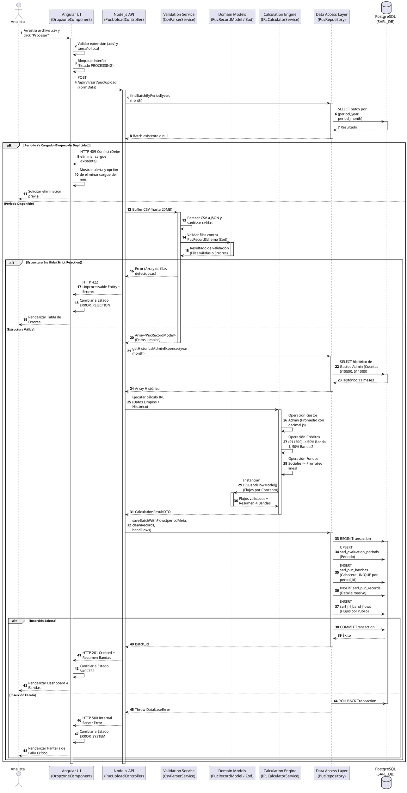
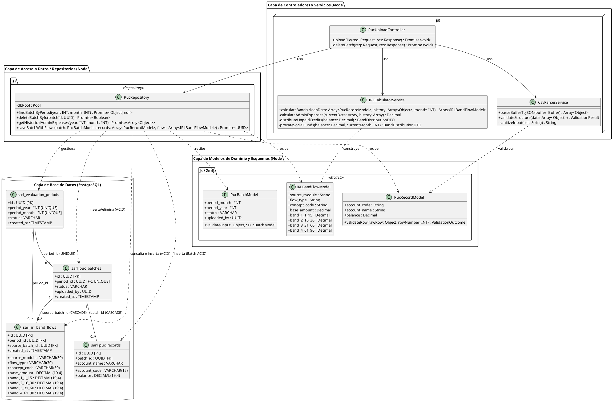

# Diagramas Arquitectónicos UML

## Módulo SARL: Submódulo Carga de PUC (MVP)

A continuación, se presentan los diagramas UML en formato PlantUML (DSL) que describen el comportamiento y la estructura del sistema.

### 1. Diagrama de Secuencia: Flujo Síncrono de Carga y Cálculo

Este diagrama detalla la interacción paso a paso desde el momento en que el usuario suelta el archivo hasta que el sistema responde con éxito o rechaza la carga bajo el patrón *Strict Rejection*.

### 2. Diagrama de Clases: Estructura de Datos y Servicios (Node.js)

Este diagrama modela la relación entre los servicios de negocio principales en el backend y el esquema de la base de datos (PostgreSQL).

